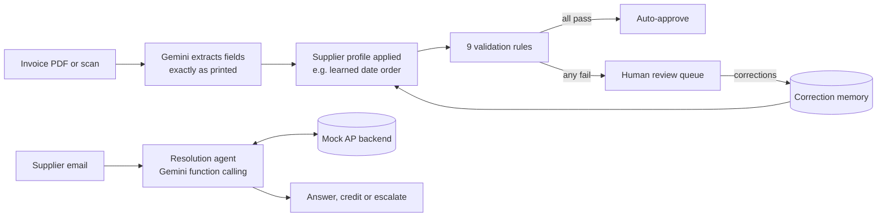

# InvoiceDesk

An accounts-payable desk for a mock small fintech: supplier invoices are extracted by an LLM, checked by
validation rules, corrected by humans (whose fixes the system learns from), and supplier emails are
resolved by a tool-calling agent. Every claim below is measured by an eval harness you can run in one command.

[](https://github.com/abdullahilyas28/invoicedesk/actions/workflows/ci.yml)
[](https://invoicedesk.streamlit.app)

**Live demo:** [invoicedesk.streamlit.app](https://invoicedesk.streamlit.app) runs on cached model results, so no API key is needed.

## Results

From [`evals/report.md`](evals/report.md), on 53 synthetic invoices and 30 synthetic support tickets.

| Metric | Result |
|---|---|
| Field accuracy (10 fields × 53 invoices) | 516/530 (97%) |
| Planted invoice errors caught by validation | 24/24, with 0 false alarms |
| Straight-through processing, before → after correction memory | 40% → 55% |
| Invoices auto-approved that were actually wrong | 0 |
| Correction memory, on held-out invoices nobody corrected | 0/6 → 6/6 fully correct (10 → 0 field errors) |
| Wrong fields flagged by the model's own confidence score | 0/14 |
| Support tickets resolved correctly | 30/30 |
| Escalation precision / recall | 8/8 / 8/8 |
| Credits issued that weren't owed | 0 |

## Try it in 60 seconds

1. Open the [live demo](https://invoicedesk.streamlit.app) and press **Process the inbox**: 21 invoices are auto-approved and 32 go to review.
2. In **Review queue**, open an *Ironbark Logistics* invoice. Its dates are wrong, because this supplier prints dates month-first.
3. Fix both dates to match the document and approve.
4. Back on **Home**, process the inbox again. The other seven Ironbark invoices now pass on their own.
5. **Tickets** shows the agent's reply and full tool-call trace for every supplier email. **Eval** shows every number above.

## How it works



- **Extraction**: Gemini reads the PDF or image and fills a Pydantic schema through constrained JSON output. The prompt tells it to copy values exactly as printed and never correct them, so planted errors survive extraction and validation can catch them.
- **Validation**: nine small, pure functions (line maths, subtotal, GST at 10%, total, ABN checksum, date order, duplicate invoice numbers, PO exists, payment terms). Any failure sends the invoice to a human with a plain-English reason.
- **Correction memory**: reviewer fixes are stored per supplier. Repeated patterns become a supplier profile that is applied in code.
- **Resolution agent**: reads a supplier email and calls six backend tools under a written [policy](data/policies.md), then ends by submitting a structured resolution. Write actions run in dry-run mode by default.
- **Eval harness**: `python evals/run_eval.py` scores everything against ground truth from cached results and writes [`results.json`](evals/results.json) and [`report.md`](evals/report.md).

## What I learned building it

### Prompt-based memory didn't work; splitting perception from interpretation did

One synthetic supplier, Ironbark Logistics, prints dates month-first (`09/04/2026` is 4 September). The base
prompt says Australian invoices are day-first, so the model confidently misreads every Ironbark date, at
self-rated confidence 1.0, and the dates still pass the date-order check. Validation only catches them through
a payment-terms rule: the 7-day terms don't match a 214-day gap.

I tried teaching the model from human corrections in the prompt, measuring each version on six invoices nobody
had corrected ([full notes](notes/memory_experiments.md)):

| Memory approach | Invoice dates fixed | Due dates fixed |
|---|---|---|
| Raw past corrections as examples | 0/6 | 0/6 |
| A rule distilled from the corrections ("this supplier is month-first") | 6/6 | 2/6, both coincidences |
| The same rule, marked highest priority, with a due-date example | 5/6 | 2/6, with run-to-run noise |
| **Model copies dates as printed; code parses them with a learned per-supplier date order** | **6/6** | **6/6** |

With one correction, the "raw examples" version appeared to fix an invoice. It turned out that invoice had the
same dates as the corrected one, so the model was doing a lookup, not learning. The lesson I took: the model was
perfect at *perception* (reading characters) and unreliable at *interpretation* when a supplier convention
contradicted its instructions. Moving interpretation into code made memory deterministic, testable, and free:
it needs no extra API calls.

### The model's confidence scores carried no information

Every one of 530 extracted fields was rated 1.0, including all 14 wrong ones. The planned rule "send fields under
0.8 confidence to review" never fired. Every error in the system was caught by a deterministic validation rule instead.

### Agent guardrails belong in code, not in the prompt

The policy says "auto-credit verified short payments up to $500", but `issue_credit` itself refuses anything over
$500, anything more than the shortfall it verifies from payment records, and a second credit for the same invoice.
`dry_run` and `ticket_id` are set by the loop and never shown to the model, so a cleverly worded email can't switch
them. Requests to change bank details always escalate, because supplier-impersonation emails are one of the most
common payment frauds.

Testing caught a real bug: in dry-run mode, the tool returned `status: dry_run`, the model assumed the credit
hadn't gone through, and it issued it again. Dry-run results now look identical to live ones from the model's
side, and the loop blocks repeat credits within a ticket.

### Read your failures before trusting your numbers

The first agent run scored 29/30. The failing reply said "November 2, 2026", which was correct, but my fact
checker only accepted day-first formats. I fixed the scorer, not the agent.

## Limitations

- **All data is synthetic.** Outside the one tricky supplier, extraction was 100% accurate, including scans. Real invoices are messier.
- **One tricky supplier, one convention.** The supplier profile currently learns date order only. Corrections that no profile rule explains still go into the prompt as examples, which this project showed is unreliable.
- **Templated tickets.** 30/30 measures policy-following on clean, single-request emails, not robustness to real inboxes.
- **Keyword fact checks.** Ticket replies are scored on whether they contain required facts. That can't judge tone, or a reply that states the right fact alongside a wrong one.
- **Small samples.** 6 held-out invoices and 8 escalation cases are enough to show an effect, not to estimate a rate precisely.
- **The agent is Gemini-specific.** Extraction goes through a provider-agnostic wrapper; the function-calling loop does not.

## Running it locally

```bash
git clone https://github.com/abdullahilyas28/invoicedesk.git
cd invoicedesk
python -m venv .venv && source .venv/bin/activate
pip install -r requirements.txt

# Demo mode: runs from the committed snapshot, no API key needed
INVOICEDESK_DEMO_MODE=1 streamlit run app/Home.py

# Tests (no API key needed)
pytest
```

To run the full pipeline yourself, put a free [Gemini API key](https://aistudio.google.com) in `.env`
(`GEMINI_API_KEY=...`), then:

```bash
python data/generate.py            # 53 invoices, ground truth
python scripts/seed_backend.py     # mock AP backend
python data/generate_tickets.py    # 30 support tickets
python scripts/process_all.py      # extract, validate, route
python scripts/run_all_tickets.py  # run the agent on every ticket
python evals/run_eval.py           # write evals/report.md
```

A run from an empty cache makes about 144 API calls, within the free tier's daily limit. Results are cached, so re-runs are free.

## Project structure

```
invoicedesk/       pipeline package: llm, schema, extract, validate, memory, pipeline, agent, backend, evaluation
app/               Streamlit app: home, review queue, tickets, eval
data/              synthetic data generators, generated invoices and ground truth, policies.md, demo snapshot
evals/             run_eval.py and its outputs
scripts/           batch jobs and debugging tools
tests/             57 tests, run in CI on every push
notes/             experiment logs behind the findings above
```

**Stack:** Python 3.12 · Gemini (`google-genai`) · Pydantic · SQLite · Streamlit · ReportLab · PyMuPDF · pytest · GitHub Actions

---

Built by [Abdullah Ilyas Siddiqui](https://github.com/abdullahilyas28)